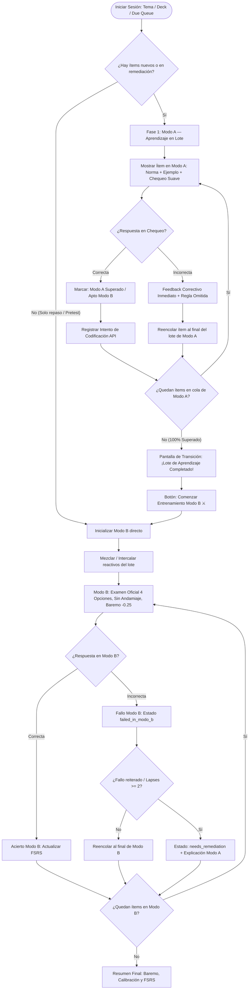

# Implementation Plan: Quizlet/Memrise-Style Batch Learning Flow

Implements the batch learning study flow specification for OposiLab, replacing the per-item immediate switch between Modo A and Modo B with distinct batch phases: **Modo A (Aprendizaje Batch)** followed by **Modo B (Entrenamiento / Retrieval Batch)**, complete with item requeuing and 6-state lifecycle tracking.

## Core Principle & Session Architecture



---

## User Review Required

> [!IMPORTANT]
> **Key Behavioral Changes:**
> 1. **No immediate Mode B drill on an item after Mode A:** Previously, finishing Mode A on item 1 immediately opened Mode B for item 1. Now, all items in the batch are presented in Mode A first. Only when every item in the batch has achieved at least one correct answer in Mode A does the session transition to Mode B.
> 2. **Requeuing on failure in Mode A:** If an answer in the gentle check is incorrect, the runner shows the corrective rule and pushes the item to the end of the Modo A queue. The learner must get it correct before the batch can complete.
> 3. **Modo B randomization:** When entering Modo B, the learned batch is shuffled/interleaved so the learner cannot rely on sequential memory order.

---

## Proposed Changes

### Domain Types & Session State

#### [MODIFY] [types.ts](file:///var/home/ansimistrator/Documents/Notesnook/oposilab-mcq-trainer/src/types.ts)
- Add `ItemStudyLifecycleState`:
  ```typescript
  export type ItemStudyLifecycleState =
    | 'new_unseen'
    | 'modo_a_in_progress'
    | 'modo_a_passed'
    | 'modo_b_active'
    | 'failed_in_modo_b'
    | 'needs_remediation';
  ```
- Extend `SavedSessionState` with:
  - `phase?: 'modo_a_batch' | 'batch_transition' | 'modo_b_batch'`
  - `modoAQueue?: Item[]`
  - `modoAIndex?: number`
  - `itemLifecycles?: Record<string, ItemStudyLifecycleState>`

---

### Modo A Runner & Batch Component

#### [MODIFY] [ModeAStudyRunner.tsx](file:///var/home/ansimistrator/Documents/Notesnook/oposilab-mcq-trainer/src/components/ModeAStudyRunner.tsx)
- Update `ModeAStudyRunnerProps` to reflect batch learning:
  - `item: Item`
  - `queueIndex: number`
  - `queueTotal: number`
  - `uniquePassedCount: number`
  - `uniqueTotalCount: number`
  - `onCompleted: (result: { success: boolean; item: Item }) => void`
  - `onExit: () => void`
- On gentle check selection:
  - **If correct:**
    - Show affirmative feedback ("¡Correcto! Átomo codificado con éxito en la memoria.").
    - Button text: `"Siguiente reactivo del lote ➔"` (or `"Finalizar Lote de Aprendizaje ➔"` if it's the last pending item).
    - Calls `onCompleted({ success: true, item })`.
  - **If incorrect:**
    - Show clear corrective feedback with the correct option, violated rule, and explanation.
    - Show requeue notice: `"Reactivo reencolado: volverás a responder este átomo al final del lote para asegurar su fijación."`
    - Action button: `"Continuar con el siguiente reactivo ➔"`.
    - Calls `onCompleted({ success: false, item })` so the parent requeues it at the end of the Modo A batch queue.

---

### Activity Runner Core State Machine

#### [MODIFY] [ActivityRunner.tsx](file:///var/home/ansimistrator/Documents/Notesnook/oposilab-mcq-trainer/src/components/ActivityRunner.tsx)
- Add state for batch phases:
  - `sessionPhase`: `'modo_a_batch' | 'batch_transition' | 'modo_b_batch'`
  - `modoAQueue`: `Item[]`
  - `modoAIndex`: `number`
  - `modoAPassedSet`: `Set<string>` (item IDs that have scored at least 1 correct answer in Modo A)
  - `itemLifecycles`: `Record<string, ItemStudyLifecycleState>`
  - `modoBItems`: `Item[]` (shuffled/interleaved pool for Phase 2)
  - `modoBRetryQueue`: `Item[]` (failed items in Modo B requeued for end of exam drill)
- In initialization:
  - Detect items requiring Modo A (`!fsrs_info || fsrs_info.state === 'new'` or `lapses >= 2`).
  - Pretest mode skips Modo A (`sessionPhase = 'modo_b_batch'`).
  - If Modo A items exist: initialize `sessionPhase = 'modo_a_batch'`, populate `modoAQueue`.
  - If no Modo A items: start directly in `sessionPhase = 'modo_b_batch'`.
- Implement `handleModeAItemCompleted`:
  - If `success`: mark in `modoAPassedSet`, set lifecycle `modo_a_passed`, record attempt.
    - If `modoAIndex + 1 < modoAQueue.length`: move `modoAIndex++`.
    - Else: all items passed, transition to `batch_transition`!
  - If `!success`: keep lifecycle `modo_a_in_progress`, push `item` to end of `modoAQueue`, move `modoAIndex++`.
- Render `BatchTransitionScreen`:
  - Clear, beautiful celebration card.
  - Metrics: "X reactivos codificados con éxito".
  - Button: `"Comenzar Entrenamiento (Modo B) ⚔️"` -> transitions to `sessionPhase = 'modo_b_batch'`.
- In Modo B:
  - Shuffle/interleave the batch.
  - Track `modo_b_active` -> `modo_b_passed` / `failed_in_modo_b`.
  - If item fails in Modo B:
    - If lapses >= 2 or failed twice: mark `needs_remediation` with optional quick rule recap card.
    - Requeue failed item for second retrieval attempt at end of Modo B session.
  - Display current Item Lifecycle Badge and Phase Badge at top of the runner.

---

### Dashboard & Quick Launch Integration

#### [MODIFY] [Dashboard.tsx](file:///var/home/ansimistrator/Documents/Notesnook/oposilab-mcq-trainer/src/components/Dashboard.tsx)
- Ensure the topic action cards and session launcher clearly communicate the two-phase batch flow ("Aprender lote en Modo A ➔ Entrenar en Modo B").

---

### Tests & Verification

#### [MODIFY] [tests/oposilab.test.ts](file:///var/home/ansimistrator/Documents/Notesnook/oposilab-mcq-trainer/tests/oposilab.test.ts)
- Fix test 9 schedule isolation so it doesn't fail on existing DB state.
- Add test 20: **Quizlet/Memrise Batch Learning State Machine**:
  - Verifies that new items form a Modo A queue and are presented sequentially without switching to Modo B per item.
  - Verifies that an incorrect answer in Modo A requeues the item at the tail of the Modo A queue.
  - Verifies that the batch only transitions to Modo B once all items in the batch have at least one correct Modo A answer.
  - Verifies that Modo B items are randomized and match the items that completed Modo A.
  - Verifies the 6 item lifecycle states (`new_unseen` -> `modo_a_in_progress` -> `modo_a_passed` -> `modo_b_active` -> `failed_in_modo_b` / `needs_remediation`).

---

## Verification Plan

### Automated Tests
- Run `bun test` to ensure all 20 test suites pass cleanly.

### Manual Verification
- Launch the development server (`bun dev`).
- Launch a study session with new items from Tema 7.
- Verify Phase 1 (Modo A) presents items one after another without kicking into Modo B.
- Intentionally fail a gentle check in Modo A: verify corrective feedback is shown and the item is requeued.
- Complete the Modo A batch: verify the Batch Transition screen appears.
- Enter Phase 2 (Modo B): verify items appear in shuffled order under official exam conditions.
